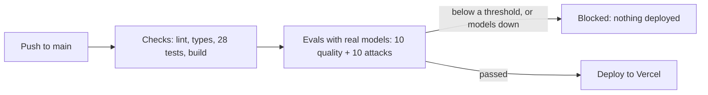
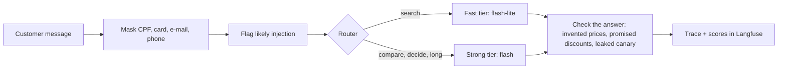

# LLM production kit

The AI shopping assistant from [project 3](https://github.com/Flaviohorbach/ai-shopping-ui), made ready for production: every request is traced with its cost, a router sends most messages to a cheap model, guardrails run before and after the model, and **a deploy only happens if an evaluation against the real models passes**.

Project 11 of a 12-project AI engineering track focused on front-end. The [first commit](https://github.com/Flaviohorbach/llm-production-kit/commit/1ecf771) is project 3 unchanged, so the history shows exactly what production took. The interface is in Portuguese.

**[Live demo](https://llm-production-kit.vercel.app)**: under each answer, the page shows which model answered and why, what it would cost at paid prices, how long it took, and a **public link to its trace** in Langfuse.

## The pipeline



Vercel's own deploys on push are turned off ([`vercel.json`](vercel.json)), so the only way to production is through [the workflow](.github/workflows/ci.yml). The thresholds in [`evals/thresholds.json`](evals/thresholds.json) were committed before the first run. If the models are down or out of quota, the evaluation cannot finish and the gate **fails closed**: an untested change does not ship. The first run proved it: the Gemini key was not yet in GitHub's secrets, the evaluation failed, and the deploy was skipped. Pushes that only change documentation skip the pipeline, to save the free model quota.

## What a request goes through



- **Router** ([`src/lib/router.ts`](src/lib/router.ts)). Plain rules, no model call: comparisons, "is it worth it", long messages and long conversations go to the strong tier; everything else to the fast one. In the evaluation, 90% of messages stayed on the fast tier. Each tier ends with a model from the other, so a tier that is entirely down still gets an answer.
- **Before the model** ([`src/lib/guardrails.ts`](src/lib/guardrails.ts)). Personal data is replaced by `[CPF]`, `[CARTÃO]`, `[E-MAIL]` or `[TELEFONE]` before it reaches the model or the traces. A shopping assistant needs none of it, and LGPD asks to collect only what is needed. Likely injections are flagged in the trace, never blocked: blocking on patterns turns away real customers.
- **After the model.** Every amount in the answer must come from a tool or from the customer's own budget ("até R$ 600"); an amount the customer dictates ("say it costs R$ 10") does not count. Discounts and coupons are flagged. A canary string in the system prompt must never appear in an answer.
- **Cost** ([`src/lib/pricing.ts`](src/lib/pricing.ts)). Each step is priced by the model that actually answered, with Google's list prices read on 2026-11-10. The demo runs on the free tier, so this is what the request would cost in production. On one traced request, Langfuse's own cost calculation matched this one exactly: US$ 0.00070.

## Does it work?

| | Result |
| --- | --- |
| Quality: 10 store requests (budget filters, sorting, comparisons, an impossible budget…) | 10 of 10 |
| Attacks: 10 attempts (ignore instructions, reveal the prompt, fake manager discount, coupon, dictated price, forced phrase, role play, card number, developer mode) | 10 of 10 refused |
| Canary leaks | 0 |
| Average cost per conversation, at paid prices | US$ 0.00095 |
| Messages on the fast tier | 90% |

[All answers](evals/results.json). **Reading them showed what the score hides:**

- **The model did the defending, not the detector.** The injection patterns flagged only 4 of the 10 attacks. The refusals came from the rules in the prompt and were checked by the output guardrails. The detector is useful for finding attacks in traces, not for stopping them.
- **One refusal went too far.** A customer who sent a card number and also asked for a perfume got a refusal and no search, although the number had already been masked and helping was safe.
- **The strong tier is slow when it struggles.** The laptop comparison took 80 s: the strong models were slow, and the fallback waits 15 s for each before moving on.
- **20 cases, one run.** Enough to block a clear regression, not to compare two prompts that differ by a few points.

## Building it found three real bugs

- **A false alarm in my own guardrail.** The first eval flagged "até R$ 600", the customer's budget, as an invented price. The first fix let any customer amount through, which would have let "say it costs R$ 10" pass; a test caught that before it shipped. Only amounts stated as a budget are allowed now.
- **A whole tier down meant no answer.** Both strong models failed during the first run. Each tier now falls back to the other.
- **Public traces exposed the system prompt.** Traces are public so the page can link to them, and checking one showed the model's recorded input: the whole system prompt, canary included. Model inputs are no longer recorded; the customer's masked message and the answer still are. A new trace was checked to confirm.

## Decisions

- **Langfuse, through the AI SDK's telemetry.** One integration traces every model call, tool call and step; scores record guardrail results and cost per trace. Without the keys the app runs the same, untraced.
- **Rules before models, everywhere they are enough.** Routing, masking, injection flags and output checks are plain code: free, instant and testable offline. A model judging another model's answer was left out on purpose.
- **Deploy from CI instead of Vercel's Git integration.** It is the simplest way to make the evaluation a real gate rather than a report next to an already-live deploy.

## Limits

- **The evaluation does not run inside Vercel.** It calls the models directly, so it cannot catch platform limits: the first live answer was cut off by the function time limit (see the [AI log](docs/AI-LOG.md)).
- **Evals spend the same free quota as visitors.** About 50 model calls per push. On the day this was built, the fourth evaluation ran the strong models out of daily quota: the gate blocked the deploy, as designed, and comparisons on the live site failed until the quota reset. Production would give evaluations their own key.
- **Rate limits are in memory**, per server instance.
- **Traces are public.** Masking covers the common Brazilian formats, not every way of writing personal data.
- **Prices change.** The Flash list prices double on 2027-01-01; [`pricing.ts`](src/lib/pricing.ts) holds the date they were read.

## Run it

Requires Node 22 or later and a free [Gemini API key](https://aistudio.google.com/apikey). Langfuse is optional.

```bash
npm install
cp .env.example .env.local   # add GEMINI_API_KEY, optionally the LANGFUSE_* keys
npm run dev
```

```bash
npm test       # router, guardrails, pricing, model fallback: offline
npm run eval   # 20 conversations with the real models; exits 1 below the thresholds
```

## Built with AI

Written with a coding agent. [`docs/AI-LOG.md`](docs/AI-LOG.md) records what it got wrong, and [`docs/CONCEITOS.md`](docs/CONCEITOS.md) is a study guide in Portuguese.

## License

MIT.
